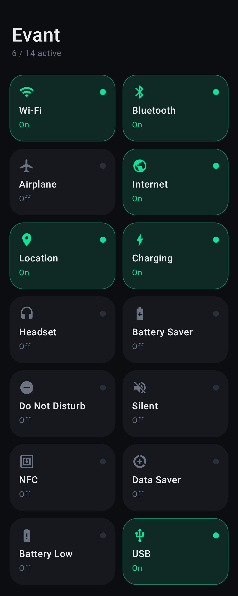
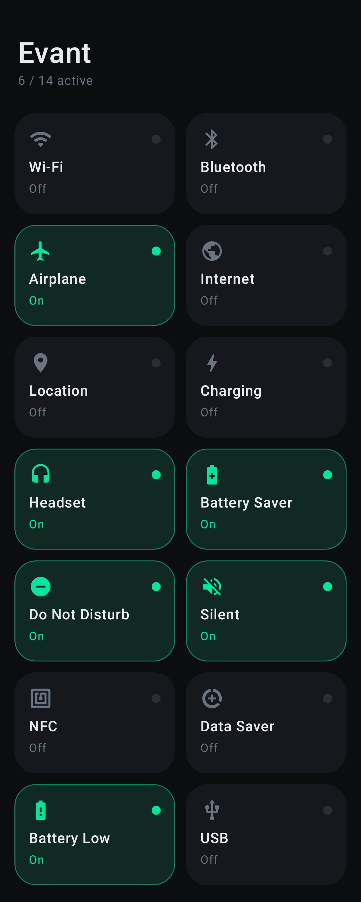

<p align="center">
  
</p>

<h1 align="center">Evant</h1>

<p align="center">
  A minimal, dark Android app that watches 14 system features in real time with
  <b>BroadcastReceiver</b>s and <b>announces every change out loud</b> ("Wi-Fi turned on", "Charger connected"…).
</p>

<p align="center">
  
  
  
  
</p>

---

## Screenshots

<p align="center">
  
  &nbsp;&nbsp;&nbsp;
  
</p>

## Features

- **14 system states** on one screen, each shown as **On** or **Off**
- **Voice announcements** through Android's built-in TextToSpeech. When several things change at once, the messages play one after another.
- **Tap a tile** to open the matching system settings panel
- **Night mode only.** The UI is minimal, with no extra text.
- Initial state is read silently, so the app doesn't speak when it opens or comes back from the background

| Feature | Broadcast action | Written with |
|---|---|---|
| Wi-Fi | `WifiManager.WIFI_STATE_CHANGED_ACTION` | Class |
| Bluetooth | `BluetoothAdapter.ACTION_STATE_CHANGED` | Class |
| Airplane mode | `Intent.ACTION_AIRPLANE_MODE_CHANGED` | Class |
| Internet | `ConnectivityManager.CONNECTIVITY_ACTION` *(deprecated)* | Class |
| Location | `LocationManager.PROVIDERS_CHANGED_ACTION` | Class |
| Charging | `ACTION_POWER_CONNECTED` / `ACTION_POWER_DISCONNECTED` | Anonymous object |
| Battery Saver | `PowerManager.ACTION_POWER_SAVE_MODE_CHANGED` | Anonymous object |
| Headset | `AudioManager.ACTION_HEADSET_PLUG` *(sticky)* | `callbackFlow` |
| Do Not Disturb | `NotificationManager.ACTION_INTERRUPTION_FILTER_CHANGED` | `callbackFlow` |
| Silent | `AudioManager.RINGER_MODE_CHANGED_ACTION` | `callbackFlow` |
| NFC | `NfcAdapter.ACTION_ADAPTER_STATE_CHANGED` | Compose effect |
| Data Saver | `ConnectivityManager.ACTION_RESTRICT_BACKGROUND_CHANGED` | Compose effect |
| Battery Low | `Intent.ACTION_BATTERY_CHANGED` *(sticky)* | Compose effect |
| USB | `android.hardware.usb.action.USB_STATE` *(sticky, hidden)* | Compose effect |

## Four ways to write a BroadcastReceiver

The project is also a learning reference. The same job is done in four styles, and every file has detailed comments in Uzbek.

**1. A separate class:** [`receiver/WifiReceiver.kt`](app/src/main/java/uz/gita/evantapp/receiver/WifiReceiver.kt)
```kotlin
class WifiReceiver(private val onChanged: (Boolean) -> Unit) : BroadcastReceiver() {
    override fun onReceive(context: Context, intent: Intent) {
        when (intent.getIntExtra(WifiManager.EXTRA_WIFI_STATE, WifiManager.WIFI_STATE_UNKNOWN)) {
            WifiManager.WIFI_STATE_ENABLED -> onChanged(true)
            WifiManager.WIFI_STATE_DISABLED -> onChanged(false)
        }
    }
}
// MainActivity: register in onStart(), unregister in onStop()
ContextCompat.registerReceiver(this, receiver, filter, ContextCompat.RECEIVER_NOT_EXPORTED)
```

**2. An anonymous object, one receiver handling many actions:** [`MainActivity.kt`](app/src/main/java/uz/gita/evantapp/MainActivity.kt)
```kotlin
private val chargingReceiver = object : BroadcastReceiver() {
    override fun onReceive(context: Context, intent: Intent) {
        when (intent.action) {
            Intent.ACTION_POWER_CONNECTED -> viewModel.onSystemEvent(CHARGING, true)
            Intent.ACTION_POWER_DISCONNECTED -> viewModel.onSystemEvent(CHARGING, false)
        }
    }
}
```

**3. Wrapped in a Kotlin `Flow`:** [`receiver/BroadcastFlow.kt`](app/src/main/java/uz/gita/evantapp/receiver/BroadcastFlow.kt)
```kotlin
fun Context.broadcastFlow(filter: IntentFilter): Flow<Intent> = callbackFlow {
    val receiver = object : BroadcastReceiver() {
        override fun onReceive(context: Context, intent: Intent) {
            if (!isInitialStickyBroadcast) trySend(intent)
        }
    }
    ContextCompat.registerReceiver(this@broadcastFlow, receiver, filter, RECEIVER_NOT_EXPORTED)
    awaitClose { unregisterReceiver(receiver) }   // unregistered automatically
}
// collected inside repeatOnLifecycle(STARTED)
```

**4. A Compose effect tied to the lifecycle:** [`receiver/ComposeBroadcast.kt`](app/src/main/java/uz/gita/evantapp/receiver/ComposeBroadcast.kt)
```kotlin
@Composable
fun SystemBroadcastEffect(vararg actions: String, onReceive: (Context, Intent) -> Unit) {
    LifecycleStartEffect(context, *actions) {
        ContextCompat.registerReceiver(context, receiver, filter, RECEIVER_NOT_EXPORTED)
        onStopOrDispose { context.unregisterReceiver(receiver) }
    }
}
```

[`receiver/BroadcastGuide.kt`](app/src/main/java/uz/gita/evantapp/receiver/BroadcastGuide.kt) explains more of the theory:
- manifest-declared and context-registered receivers, and the Android 8+ limits on implicit broadcasts
- the `RECEIVER_EXPORTED` / `RECEIVER_NOT_EXPORTED` flags (required on Android 14+)
- normal, ordered, sticky, protected, local (deprecated) and custom broadcasts
- running work on the main thread, the ~10 s ANR limit and `goAsync()`

## Architecture

```
app/src/main/java/uz/gita/evantapp/
├── MainActivity.kt          # registers receivers (styles 1–4), opens settings
├── MainViewModel.kt         # StateFlow<Map<SystemFeature, Boolean>>, speaks only on real changes
├── model/
│   ├── SystemFeature.kt     # enum: title, spoken text, icon, settings action
│   └── SystemStateReader.kt # reads the current state from system services and sticky intents
├── receiver/                # all BroadcastReceiver code + BroadcastGuide.kt
├── sound/Announcer.kt       # TextToSpeech wrapper (queues speech until the engine is ready)
└── ui/                      # MainScreen (Compose grid) + dark-only theme
```

**How an event flows:** system broadcast → `onReceive()` → `MainViewModel.onSystemEvent()` → if the state really changed, update the `StateFlow` and call `Announcer.speak()` → the Compose UI recomposes.

## Build & run

```bash
git clone <repo-url>
cd EvantApp
./gradlew installDebug
```

Requirements: Android Studio (latest), JDK 17+, and an Android 7.0+ device with a TTS engine (Google Text-to-Speech is preinstalled on most phones).

The app needs only normal permissions, which are granted at install time: `ACCESS_WIFI_STATE`, `ACCESS_NETWORK_STATE`, and `BLUETOOTH` (API ≤ 30).

### Test with adb

```bash
adb shell svc wifi disable                       # "Wi-Fi turned off"
adb shell svc wifi enable                        # "Wi-Fi turned on"
adb shell cmd connectivity airplane-mode enable  # "Airplane mode on"
adb shell settings put global low_power 1        # "Battery saver on"
adb shell dumpsys battery unplug                 # "Charger disconnected"
adb shell dumpsys battery set level 10           # "Battery is low"
adb shell dumpsys battery reset
```

## Notes

- Receivers are active only while the app is visible (`onStart`–`onStop`). Changes made while it is in the background are applied silently when you return.
- On Android 10+, apps can't switch Wi-Fi or Airplane mode on or off directly, so tapping a tile opens the matching system panel instead.
- `CONNECTIVITY_ACTION` is deprecated and is kept on purpose for learning. The modern replacement is `ConnectivityManager.registerDefaultNetworkCallback()`.
